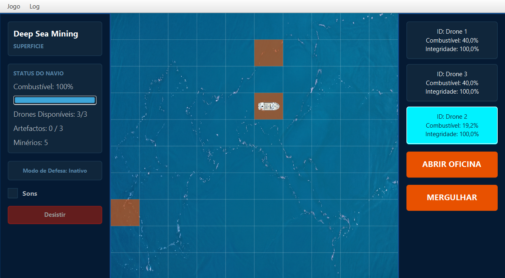
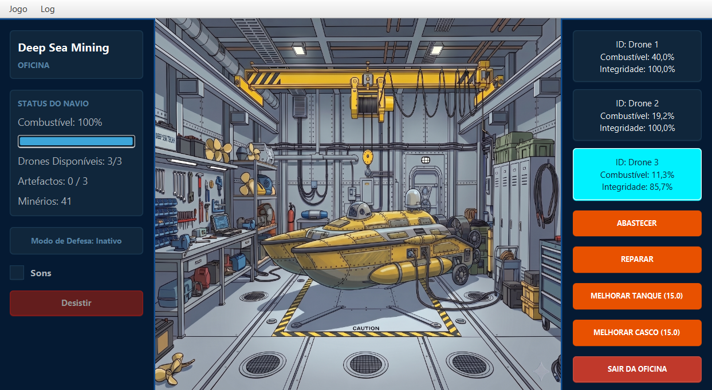
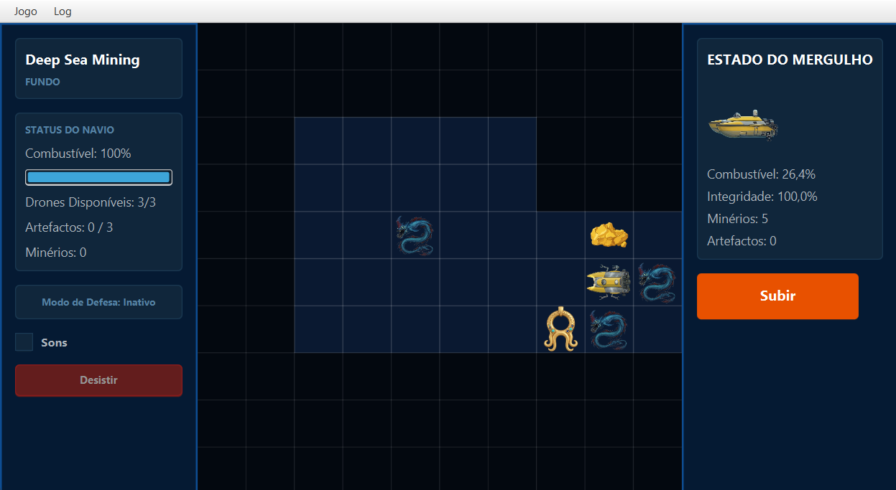

# Deep Sea Mining

> **Note:** This repository is a copy of the original project (which was originally archived), so it does not preserve the individual commit and contribution history of each of the three team members.

**Deep Sea Mining** is a strategy, underwater exploration, and resource-management game built in **Java** with **JavaFX**.

Take command of a surface **Mothership** and manage a fleet of **3 submarine drones** on an expedition into the abyss. Your mission is to navigate treacherous ocean depths, mine valuable ores, upgrade your fleet, and recover **3 ancient artifacts** hidden on the seabed before your ship's fuel or your drones run out.

---

## Gameplay & Mechanics

The ocean is divided into three distinct 10×10 layers, where every tactical decision impacts the survival of your expedition:

- **Surface:** Your base of operations. Navigate horizontally across the ocean, select active drones from your fleet, enter the workshop, and deploy drones into the depths.
- **Ocean Trench:** A vertical descent and ascent shaft filled with hazards. Steer past **rocks**, avoid **marine animals** that damage your hull, and push through **strong water currents** that double fuel consumption.
- **Seabed:** A 2D exploration zone shrouded in **Fog of War**. Uncover **ore deposits**, evade wandering **sea monsters**, and track down the hidden **artifacts**.
- **Artifact Extraction Puzzle:** Discovering an artifact triggers a 4×4 sliding puzzle (tiles 1–15) that must be solved within **50 moves** before an energy failure occurs. Every generated board is guaranteed to be solvable.
- **Workshop:** Dock your drones on the ship to **refuel**, **repair hull integrity**, and spend collected ores on **upgrades** that expand fuel tank capacity and hull durability — complete with 3 visual upgrade tiers for each drone.

---

## Key Features

- **Distinct Ocean Layers & Visual Progression:** Explore unique environments from the surface down to the abyss, with real-time mission stats and drone designs that evolve across 3 upgrade tiers.
- **Atmospheric Sound Design:** Hear the ocean come alive with sound effects for navigation, mining, artifact discoveries, upgrades, repairs, strong currents, monster encounters, and explosions.
- **Save & Continue Anytime:** Save your expedition progress at any moment and pick up right where you left off, with quick access to your recent saves.
- **Mission Log:** Keep track of every discovery, hazard, and action with a live mission log that you can view anytime or export.

---

## Tech Stack

- **Java 25**
- **JavaFX 21.0.2** (`javafx-controls`, `javafx-media`)
- **Maven**
- **JUnit 5 (5.10.2)**

---

## Sneak Peak

  
  

## Authors

- **Guilherme Eça (@gitgui0)**
- **Luana Rabello (@luanarabello)**
- **Miguel Zara (@mZara21)**
